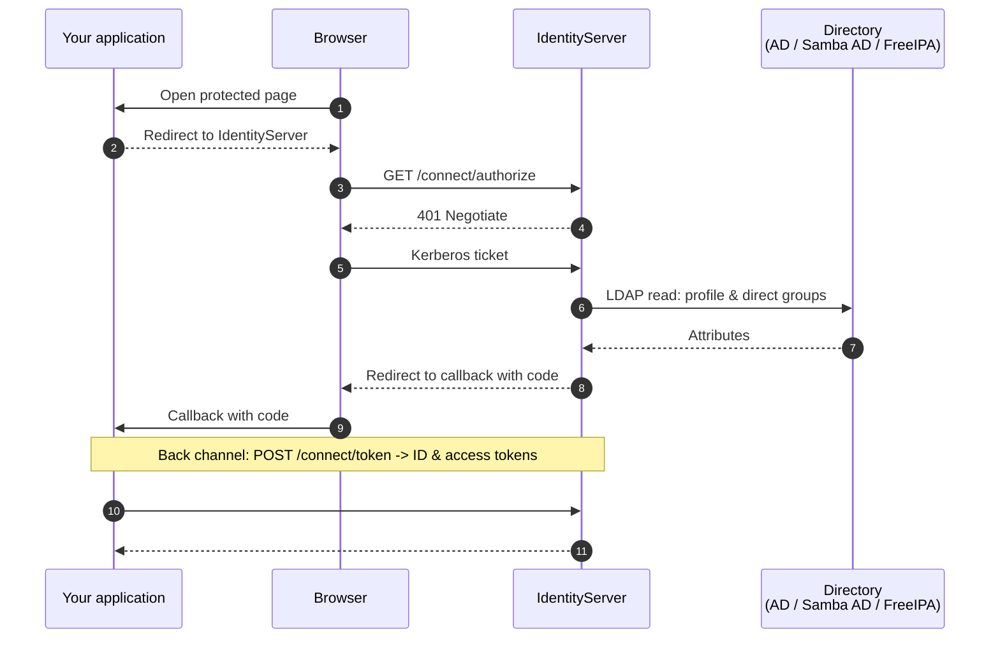

# IdentityServer

OpenID Connect server for Active Directory, Samba AD, and FreeIPA using Windows/Kerberos integrated authentication, built on ASP.NET Core 10 and OpenIddict. *(Not affiliated with Duende IdentityServer.)*




Serves OIDC discovery, JWKS, authorization, and token endpoints (authorization code with PKCE, implicit, and hybrid flows; no refresh tokens). Emits durable `sub` claims (Windows SID or FreeIPA `ipaUniqueID`), profile/email claims, and `role` claims for direct groups matching configured regexes.

## Packages and install

**Standalone server:** Download the Windows or Linux archive from [Releases](https://github.com/auroris/AurorisNet.IdentityServer/releases), or publish from source (`dotnet publish IdentityServer.csproj -c Release -o artifacts/publish`). Run locally on Windows with:

```powershell
dotnet run --project IdentityServer.csproj --no-launch-profile -- --urls http://localhost:5000
```

**NuGet packages:**

| Package | What it adds |
|---|---|
| `AurorisNet.IdentityServer` | Embeddable OIDC server and directory providers for ASP.NET Core 10 (Windows & Linux). |
| `AurorisNet.IdentityServer.Directory` | Active Directory people and group lookup for address books and pickers (Windows only). |
| `AurorisNet.ActiveDirectory` | `System.DirectoryServices` wrappers for AD users, groups, computers, and printers (Windows only). |

## Key settings (`IdentityServer` section)

| Setting | Default | Effect |
|---|---|---|
| `ServerUri` | `*` | Public issuer URL (set explicitly in production). |
| `Hosts` | none | Allowed callback/CORS origins (**hostname match only**; empty rejects all requests). |
| `Clients` | none | Allowed `ClientId` / optional `ClientSecret` entries (empty allows any client ID). |
| `Groups` | none | Regexes matching direct group CNs emitted as `role` claims. |
| `PersistKeys` / `DataPath` | `false` / `keys` | Persist signing/encryption keys (`KeyProtectionPassword` required on Linux; DPAPI on Windows). |
| `Authentication:Mode` | `Auto` | `Negotiate`, `Kerberos`, or `ProxyKerberos`. |
| `Directory` | `Auto` | Directory provider (`Windows` on domain-joined Windows, else LDAP for AD/Samba AD/FreeIPA). |

Replace the demonstration values (`optional`, `localhost`, `oidcdebugger.com`) in `appsettings.json` before deploying.

## Documentation

| Guide | Covers |
|---|---|
| [How it works](docs/how-it-works.md) & [Configuration](docs/configuration.md) | Sign-in flow, every setting, scopes, claims |
| [Directory providers](docs/kerberos-and-ldap.md) | Active Directory, Samba AD, and FreeIPA LDAP setup |
| [Windows and IIS](docs/windows-iis.md) | IIS / Kestrel deployment, SPNs, browser trust |
| [Linux](docs/linux-deployment.md) & [Apache and Nginx](docs/apache-and-nginx.md) | Keytabs, systemd, reverse-proxy auth, `deploy/` templates |
| [Embedding the core](docs/embedding.md) | Using the NuGet packages in your own app |
| [Verification](docs/verification.md) & [Troubleshooting](docs/troubleshooting.md) | Deployment checks, log walkthrough, common errors |
| [Developing](docs/developing.md) & [Release assets](docs/releasing.md) | Building, tests, packing, and release automation |

## License

[MIT](LICENSE)
